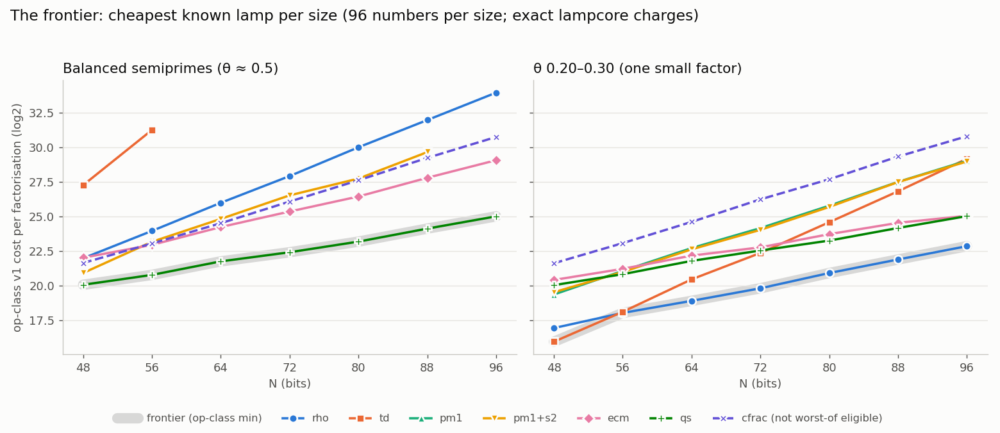

# lumens-per-watt

How much of the number line does each step of a factoring algorithm light up, per unit of real cost?

lumens-per-watt evolves and tunes integer-factoring pipelines and scores them by the work they actually do. Each method is a **lamp**: trial division, Pollard rho, Pollard p-1, ECM and a self-initializing quadratic sieve ("qs"). A pipeline is a sequence of lamps, each with a budget. Every operation a lamp performs is charged on an exact **op meter**, and pipelines are compared by how cheaply they find factors.

The picture behind it: place a number's smaller factor on the line θ = log p / log N, from 0 (tiny factors) to ½ (balanced semiprimes). Each lamp lights part of that line brightly and the rest dimly. Some regions are walls, expensive to light by any method. A good pipeline covers the line with the least total cost.

Independent research by Jonathan Kendall. Rust ("lampcore") for the fast core, Python for the harness and analysis; the two cores must agree exactly.

## Findings so far (Oct 30, 2026)

Every claim below is scoped to its sizes, budgets and pricings. Details: [NOTES.md](NOTES.md) (cost models, runs, results) and [MOVES.md](MOVES.md) (ideas and their statuses).

**A sealed program search rediscovered Pollard rho (arrangement-v1).**
- **The family:** about 15 "arrangement + detection rule" pairs (stride walks, folds, polynomial maps, bins, exponent towers; per-dot, batched, Floyd, Brent and bin-compare detection), searched by coordinate search.
- **The judge:** pinned by hash, checked before and after each scored run, with the search sandboxed away from held-out numbers.
- **The pick** on balanced numbers was a polynomial map with Brent cycle detection, i.e. rho.
- **Held-out cost:** 0.99 × rho at 64 and 80 bits (robust over op-class, ruint, Montgomery and a size-scaled gcd price; intervals about ±20% at 48 numbers per size).
- **Selection bias:** its growth fitness fell from 1.048 on training numbers to 0.968 held out, which is why held-out numbers are kept.
- **On numbers with one small factor** (θ 0.20–0.30) the search again picked a rho variant. p − 1 lost on cost.
- **Forecasts:** 20 sealed forecasts from three forecasters: 15 genuine passes, 3 not falsified by default, 2 falsified.
- **Scope:** 48–96 bits, the search's budget (16 × rho's worst training cost per number); no genome beat rho by more than about 15–20%.

**Growth fitness can be bought by padding.** A genome that is dearer at the bottom of the size range looks as if it grows slowly. The θ pick did this: 1.27 × rho at 64 bits, 0.99 × at 80. The rules for future families therefore require:
- **a slope win** to be no dearer than the reference at any measured size;
- **a level win** to be cheaper at every size under every pricing in the worst-of set.

**Two candidate families were stopped at the pre-check, before any search code.**
- **Square-form walks (SQUFOF-like):**
  - **Measured:** its step constant, and the cost of a 64-bit division on this machine.
  - **Expected cost:** 1.31–1.41 × rho at 48–80 bits under the worst-of pricing, even at the low end of the measured step count. One-word arithmetic does not make up for the extra steps once divisions are timed.
- **Change the group (p − 1, p + 1, small elliptic curves):** wins exist only for lamps already in the project (ECM, and p − 1 with stage 2) on balanced numbers. p + 1, the new member, wins nowhere, and on θ 0.20–0.30 numbers no group method beats rho at 48–64 bits.

**The measured frontier:** the cheapest existing lamp per size, exact charges, frozen genes, 96 fresh numbers per size, robust over the worst-of pricing set.
- **Balanced:** the quadratic sieve at every size from 48 to 96 bits. At 48 bits p − 1 with stage 2 ties it under some pricings.
- **θ 0.20–0.30:** rho at 56–96 bits; trial division at 48 under op-class.
- **No crossovers in 48–96.** This frontier is the reference future families must beat.



## How it is measured

- **The op meter.** Every operation is charged by what it physically is (a fixed classification rule): a full multiply mod N, a reduction modulo a small prime, a word-level step (an add, a compare, an index move), a gcd, and so on.
- **Three pricings of the same counts.**
  - official: every op costs 1;
  - ruint: prices relative to a generic 256-bit multiply, calibrated on this machine;
  - Montgomery: prices relative to a fast multiply.
- **Two tracks.** Track R (robust: worst of the three pricings) and Track M (Montgomery decides).
- **Discipline.**
  - Predictions are registered before results, including those of outside reviewers.
  - Claims are confirmed on sealed fresh numbers, per size band, with paired bootstrap intervals.
  - The reference changes only through a pre-registered replacement rule.
  - Every change to the card or the meter comes with a cost-model entry first, an acceptance test, and a full Python/Rust parity run.
  - Meter corrections (charging work that was uncharged) are kept separate from re-pricings (charging the same work at its correct type), and each is reported on its own.

## Where it stands (Oct 2026)

- Two-track size scaling at 54-96 bits is done. Stage-1 p-1 pays for Track M at every size; for Track R only at 54 bits.
- The quadratic sieve's reference genes were replaced through the replacement rule. Most of the gain came from fixing the card, not from tuning.
- An audit of the meter is in progress. It found:
  - operations charged above what they physically are (the Gray-code root update; candidate evaluation; search, sort and bookkeeping steps);
  - operations not charged at all (the ledger's duplicate check; sieve start offsets; a sort inside re-sieving).
  Each is being corrected with its own cost model, parity run and report.
- Root-matched confirmation ("re-sieve") pays only when its prime cutoff p0 is tuned. A cost model puts the best p0 in the hundreds at 84-96 bits, and suggests it matters for Track M but barely for Track R. A scored slack retune with a p0 sweep is next.
- Large-prime pairing is explained by three things: only quadratic-residue primes can occur (halving the support), the filed size distribution, and pooling across numbers. The double-large-prime variation stays marginal at these sizes.

## How this project works

- **Sealed predictions.** Every scored experiment has its predictions committed in `predictions/` before it runs, including those of outside reviewers (DeepSeek), whose rounds are kept in `reviews/`.
- **The guard.** Scored runs go through `tools/sealed_run.sh`. It refuses to run unless the predictions are committed and unchanged, and it commits each run's output to `results/`, naming the prediction commit.
- **Model against card.** Model work (Wolfram, run from the command line in `wolfram/`) produces forecasts, recorded as "model" and never scored. Only the card's measured runs score predictions.
- **The record.** Results and scores are in `NOTES.md`, which is append-only. The full workflow is in `PROTOCOL.md`.
- **Decisions.** Nothing is adopted, retuned or pushed without the author's decision.

New ideas and opportunities are logged and evaluated in `IDEAS.md`.

Details, numbers and every prediction with its score are in `NOTES.md`; candidate moves in `MOVES.md`; the plan in `PLAN.md`.

## Roadmap: the Illumination program

After the current meter corrections, five phases (full plan in `PLAN.md`):

1. **Watt meter.** Measure real energy (CPU energy counters), instructions and time per run and per phase, and check them against priced cost. A phase that costs more in joules than its price says is hiding work. This makes "lumens per watt" literal, and turns meter holes into something a run detects rather than something found by reading code.
2. **Price map.** Since cost is op counts times a price vector, store the counts and show, for any two pipelines, the region of price space where each wins, instead of judging at three fixed hardware points. Decisions become boundaries, such as "re-sieve pays when word / small-modulus price is below r*".
3. **Light spectrum.** Replace a single efficiency number with a curve: the probability of success as a function of θ, per unit cost, for each lamp and pipeline. Pipelines are compared by which curve dominates, and the dark regions of the line become visible.
4. **Hazard monitor.** Track each running stage by its chance of success in the next unit of cost (or, for qs, relations collected toward F + 10), giving anytime curves and a rule for when to switch lamps.
5. **Dark mass.** Treat the factor's position on the θ line as uncertain. Every stage, including one that fails, rules part of it out. Score lamps by bits of uncertainty removed per unit cost, and schedule them greedily by that measure.

## Repository layout

- `lampcore/`: the Rust core (lamps, op meter, per-type counters, benchmarks)
- `evolve/`: the Python harness (lamps, ledger, qs, pricing, tuning, acceptance and parity tests, analysis scripts)
- `NOTES.md`: the running lab notebook: decisions, cost models, results, predictions and scores
- `MOVES.md`: candidate moves (card changes, pricing changes, search methods) and their status
- `PLAN.md`: the plan and the order of work
- `IDEAS.md`: ideas and opportunities: proposed, adopted, parked, rejected

## Running it

```
cd lampcore && cargo build --release   # the fast core the harness calls
cd ../evolve
python3 evolve.py 25 20 8      # generations, population, worker processes
python3 validate.py            # champions vs baselines on fresh 36–54 bit numbers
python3 ancestry.py            # family line of each run's champion
python3 ancestry.py N11-0076   # family line of any named genome
```

Outputs: `evolve.log`, `results.json`, `lineage.jsonl`, `validation.json`. Runs are seeded, so the same commands reproduce the same numbers on any machine.

## License

License: MIT (see [LICENSE](LICENSE)). Copyright (c) 2026 Jonathan Kendall.
