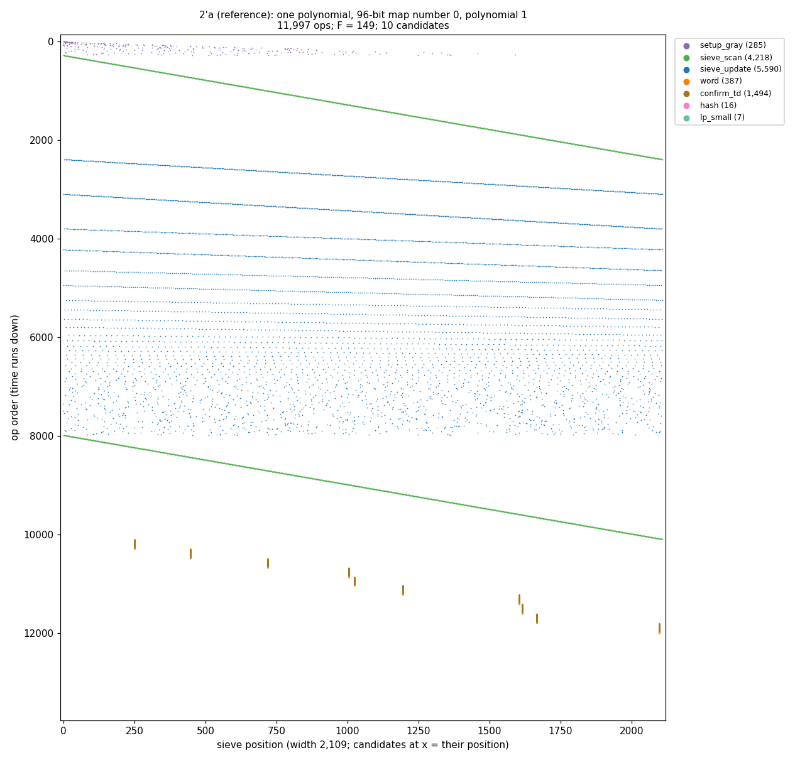
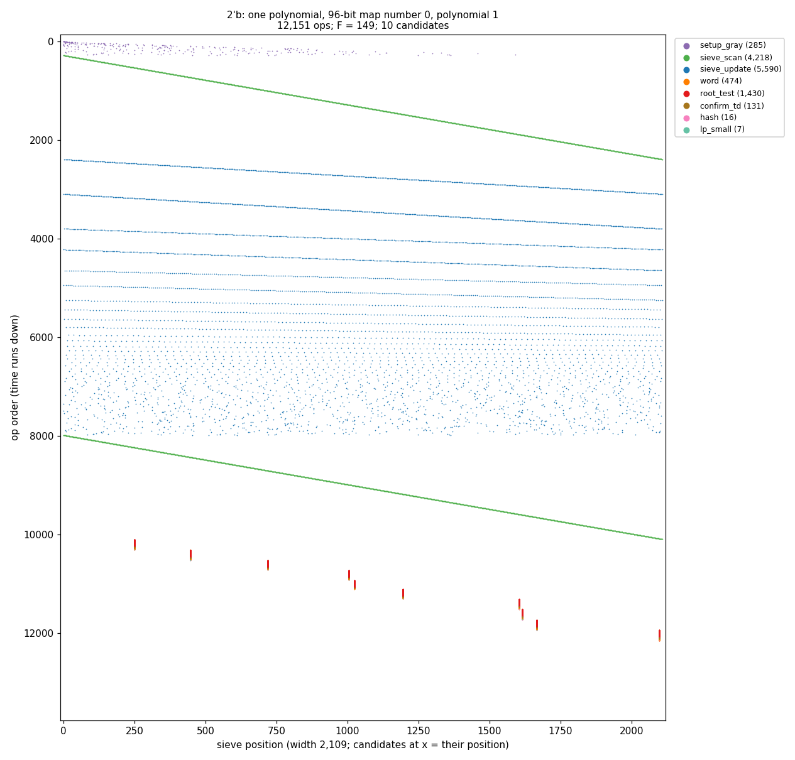
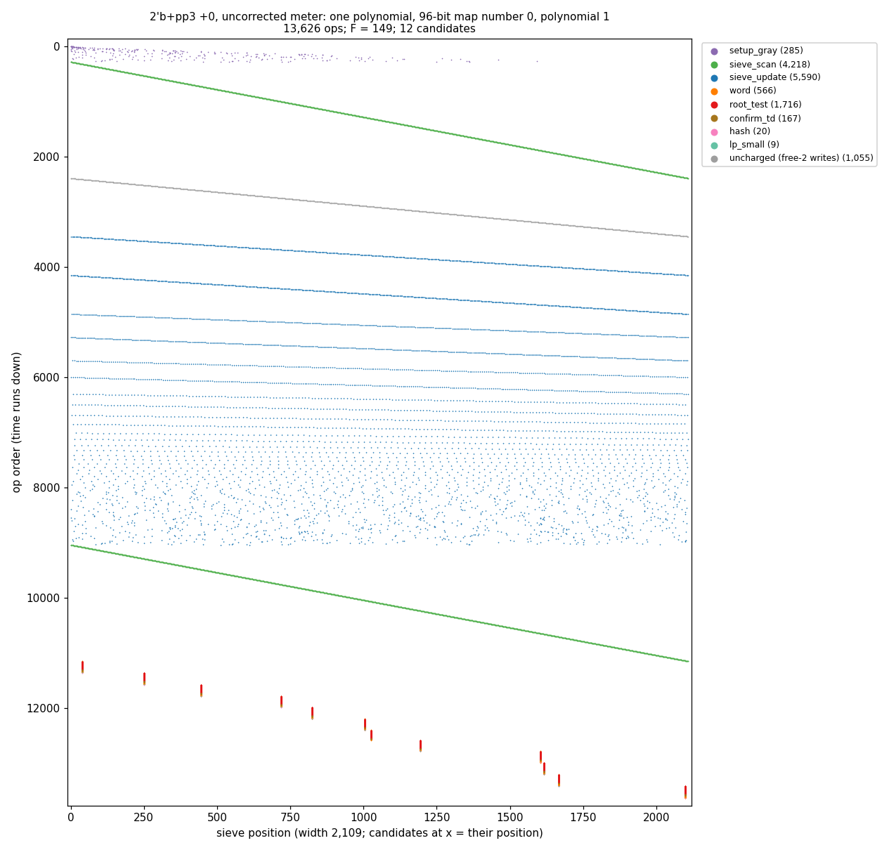
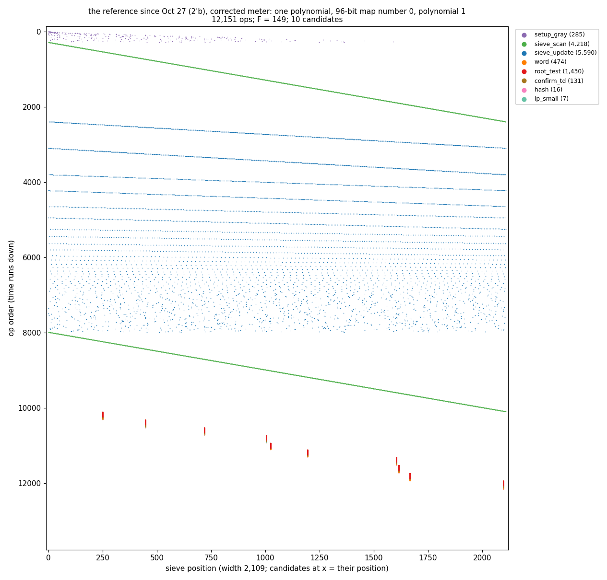

# Work traces (IDEAS I-044): one polynomial's work as motion on the sieve line

A prototype, information only. Made by `evolve/worktrace.py` from the Python card, which matches lampcore op for op by parity. lampcore is untouched.

**How to read every picture:**
- **What is shown:** one polynomial, the run's second, which is the first with a Gray-code switch, of the first 96-bit map number.
- **Horizontal:** the sieve line, positions 0 to 2,108 (the interval [−M, M]).
- **Vertical:** op order, with time running **down**. Every dot is one op, at the position it touches. Work done per candidate (a root test, a trial division) sits at that candidate's position.
- **Colours:** dots take the colour of the type the meter charges them as. **Grey is work the meter does not charge.**
- **Axes:** all four pictures share the same axes, so their heights compare directly.
- **Approximate:** the per-candidate word and hash marks are placed approximately, by the trace hook.

The work reads top to bottom:
1. **A purple scatter at the very top:** the Gray switch updating every root's offset (setup_gray).
2. **A long green diagonal:** the array cleared, one cell at a time.
3. **Blue horizontal streaks:** each base prime's sieve walk. Small primes are dense streaks that take many ops; large primes are sparse ones that take few. Together they become a speckled band.
4. **A second green diagonal:** the scan for candidates.
5. **Short vertical ticks near the bottom:** the candidates. Each tick is that candidate's confirmation work stacked in time.

## 2′a: the reference until Oct 26–27 (goff = 1, full-pass confirmation)

The candidates' ticks are **brown**: each candidate is trial-divided by every factor-base prime, about F − 1 = 148 small-modulus divisions (confirm_td). These are the tallest ticks of the four pictures.

## 2′b: root confirm on top of 2′a

Everything above the candidates is the same as 2′a: the same gray, clear, walks and scan. The ticks change colour: they are mostly **red** (root_test), one cheap root test per sieved prime, with a short brown tail of real divisions only for the primes that hit.

The old root-confirm design, before 2′b, would have shown a **second pass per polynomial** here: an extra sweep storing every root's start offset. 2′b reads the offsets the Gray code already keeps, so there is no such sweep.

## 2′b+pp3 at +0 bits, under the uncorrected meter (before 6031239)

The **grey diagonal** between the green clear and the first blue walks is the free-2 initialisation: a write to every second cell (a stride-2 band, about 1,055 writes). Before the free-2 meter correction it was **uncharged**. The picture makes the hole visible: an entire sweep of the line that the meter did not see. Since 6031239 it is charged as sieve_scan.

pp 3 also adds more candidates (12 here, against 10), so there are more ticks.

## The reference since Oct 27 (2′b), under the corrected meter

This is the adopted reference. It has no pp, so the free-2 correction does not touch it: its trace is op for op the 2′b picture above (12,151 ops). It is shown under its own name as the baseline for future traces.

## What this does not show

- **Time:** one dot is one counted op, not one nanosecond. A root test and a trial division take the same vertical space here, though they differ in instructions (op-class v1: 52 against 108) and in time.
- **The per-A setup:** the inverses and the roots for each A, done before this polynomial.
- **Other polynomials:** only one is shown.
- **Other lamps:** a later version could trace rho (the Wander) and ECM.
